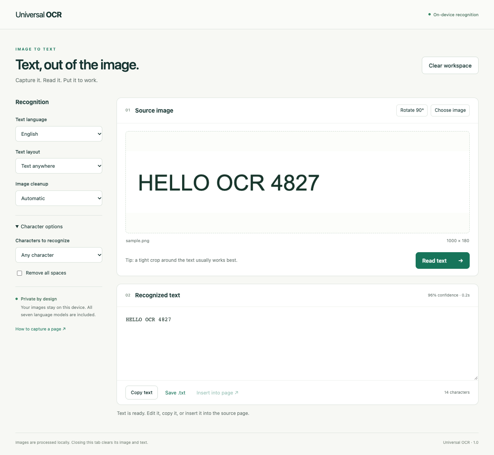

# Universal OCR

A private, independent browser extension that turns images and page regions
into editable text. Recognition runs locally with Tesseract.js; no API key,
account, server, or runtime download is needed.



This project was requested to provide the general-purpose OCR feature listed
as “Coming Soon” in [CaptchaSonic-Extension](https://github.com/Captcha-Sonic/CaptchaSonic-Extension).
That public repository contains documentation and packaged releases, but no
extension source at commit `6162d94`. Its `Licence` file restricts modification,
despite the README describing an MIT license. This is a new implementation
that can be installed alongside CaptchaSonic. It does not include or modify
CaptchaSonic’s proprietary software or replicate its other solvers.

## Install

1. Download and unzip `universal-ocr-1.0.0-chromium.zip` from this repository’s Releases.
2. In Chrome, open `chrome://extensions` and enable **Developer mode**.
3. Choose **Load unpacked**, then select the extracted folder containing `manifest.json`.
4. Pin **Universal OCR** in the browser’s Extensions menu.

For Edge, use `edge://extensions`; Brave uses `brave://extensions`. Requires
desktop Chromium with Chrome 116 APIs or newer. Firefox and mobile builds are
not included.

## Use

- **Page region:** open the toolbar popup → **Select a region** → drag around the text.
- **Whole viewport:** choose **Read the visible page**.
- **Right-click / shortcut:** choose **Read text in a region**, or press **Alt / Option + Shift + O**.
- **Your own image:** open **Upload or paste an image**; browse, drop a file, or paste a screenshot.
- **Short codes:** select **Single line / code** or **Single word**, optionally limit characters and remove spaces.
- **Output:** edit, copy, save as `.txt`, or **Insert into page** and click a text field on the original page.

Recognition starts automatically when an image is loaded. After changing
settings or rotating, click **Read text** again. **Cancel** stops recognition;
**Clear workspace** releases the current image and text.

Field insertion replaces the selected field’s contents, dispatches `input`
and `change`, and does not submit forms. It targets the original document;
after navigation, capture again or use Copy text. Fields inside embedded
frames are not supported.

### Languages and accuracy

English, Spanish, French, German, Japanese, Korean, and simplified Chinese are
bundled. Choose the language matching the source. Input formats: PNG, JPEG,
WebP, BMP, and GIF (still frame), up to 15 MB. Use screenshots for PDFs.

OCR works best on readable printed text. Handwriting, heavily distorted text,
unusual fonts, and complex backgrounds can require corrections. “Universal”
means the tool accepts general images and visible page regions; it does not
guarantee recognition of every CAPTCHA or solve image puzzles. The confidence
score is an estimate, not an accuracy guarantee. Try a tight crop, different
layout, original colors, or high contrast when a result is poor.

## Privacy and permissions

All code, WebAssembly, and model files are packaged locally. The extension’s
content security policy blocks external network connections. There is no
analytics or cloud OCR.

- `activeTab` and `scripting`: capture and select text only after you invoke the extension; no permanent access to all sites.
- `contextMenus`: adds the region capture menu item.
- `storage`: saves recognition preferences locally and temporarily holds captures in browser session storage.

Images and results live in workspace memory. Closing/reloading the workspace
clears them. Pending captures are removed when opened, rejected after ten
minutes, and purged on the next capture; session storage also clears when the
browser exits. Recognition results are not saved to browser storage. Saving
or copying output is an explicit action.

Browser settings pages, extension stores, and some PDF viewers restrict
injection/capture. Upload or paste a screenshot there. Local file pages may
need **Allow access to file URLs** enabled in the extension’s settings.

## Build and verify

Requires Node.js 22+, npm, and `zip` (for packaging).

```sh
npm ci
npm run check
npm run package
```

Load the resulting `dist/` folder as an unpacked extension. Packages and
checksums go to `artifacts/`. Models come from pinned npm packages and their
integrity hashes in `package-lock.json`; building needs internet access to
install packages, but the installed extension does not.

`npm test` checks high-DPI crop mapping, selection boundaries, image memory
limits, settings validation, text normalization, and real OCR against printed
text and numeric fixtures using a local model.

For the browser suite:

```sh
npx playwright install chromium
npm run build
npm run test:browser
```

The browser suite loads the actual extension in isolated Chromium, disables
network access, and verifies recognition in all seven languages, character
options, image cleanup, cancellation and retry, blank/corrupt/oversized input,
rotation, text export, and clearing. Install system CJK fonts if your platform
does not provide them. Reports and screenshots go to `output/playwright/smoke/`.

For manual capture and field-insertion verification, run `npm run demo`, open
the printed-code fixture at `http://127.0.0.1:4173`, and use the real extension
shortcut. The page counts input/change events and form submissions.

See [verification notes](docs/verification.md) for the checked workflows and
their limits.

## Source map

| File | Responsibility |
| --- | --- |
| `src/background.js` | Capture routing, temporary image handoff, original-document insertion |
| `src/content.js` | Frozen region selector and field picker |
| `src/ocr.js` | Local Tesseract worker, progress, cancellation, timeout |
| `src/image.js` | Input validation, crop, rotation, cleanup and scaling |
| `src/workspace.js` | Image input, settings, recognition and text output |
| `scripts/build.mjs` | Bundle code, worker, WebAssembly, languages, icons and notices |

See [THIRD_PARTY_NOTICES.md](THIRD_PARTY_NOTICES.md) for dependencies and licenses.
