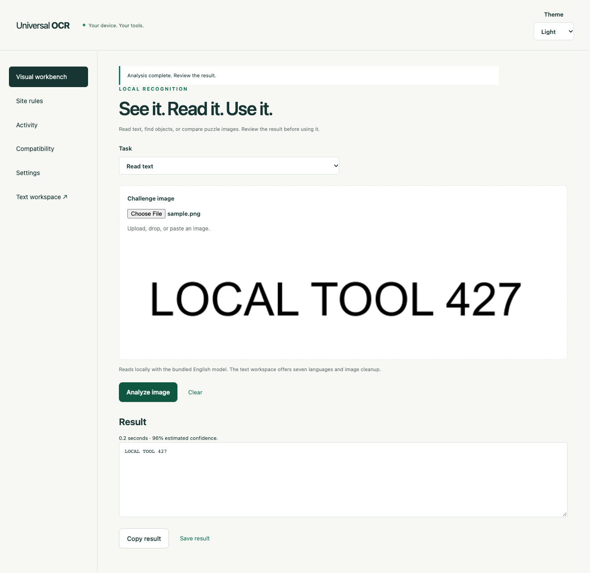

# Universal OCR

An independent, open-source browser extension and local recognition service. Read text from images and page regions, analyze visual challenges, and configure automation for specific sites. No paid CAPTCHA subscription is required for the implemented local tools.



Version 2.5 adds native reCAPTCHA v3 actions, AWS WAF grids and split-image sliders, Binance sliders and one/two-page grids, and Geetest v4 ordered-icon and image-grid modes. Google's official v3 demo passed through the full extension in 425 ms. The other new modes have different evidence and limits; see the [2.5 verification report](docs/verification-2.5.md).

Version 2.4 adds an experimental TikTok slider, circle-rotation, and same-shape-pair adapters, fixes the Geetest v3 popup layout, and reduces rotation and repeat-start work. TikTok live acceptance remains unverified. See the [2.4 verification report](docs/verification-2.4.md).

Version 2.3 added bounded hCaptcha matching-shapes clicks, scaled-sprite capture, and brief success-marker handling. See the [2.3 verification report](docs/verification-2.3.md).

Version 2.2 added dedicated text-code recognition, MTCaptcha field handling, Geetest and Tencent slider adapters, and native Procaptcha / CaptchaFox workflows. Procaptcha proof of work and CaptchaFox's object slider passed official public demos with the **Browser Input** build. Geetest and MTCaptcha live tests did not confirm acceptance. This is not full CaptchaSonic parity: see the [capability matrix](docs/COMPATIBILITY.md) and [measured results](docs/verification-2.2.md).

The referenced [CaptchaSonic repository](https://github.com/Captcha-Sonic/CaptchaSonic-Extension) contains documentation and release assets, but no extension source at the inspected commit. This project includes none of its code, binaries, artwork, or branding.

## CAPTCHA support status

**This project does not support all CAPTCHA types advertised by CaptchaSonic.** This table describes version **2.5.0**. Detection, generic image tools, and local fixtures do not establish live provider acceptance.

| CAPTCHA type / feature | Status | What works and what is missing |
| --- | --- | --- |
| PopularCaptcha (Image / Grid / BBox / Multi) | **Partial — hCaptcha grid subset** | CaptchaSonic uses this name for hCaptcha-style challenges. The hCaptcha grid and experimental matching-shapes adapters apply; live acceptance and other click/drag/video/token workflows remain unverified. |
| reCAPTCHA v2 (Visible & Invisible) | **Partial — visible grids** | Capture, replacement tiles, multiple rounds, and optional Verify; one 2.1 public-demo success. Invisible flows, audio, and other modes remain unverified. |
| reCAPTCHA v3 | **Official demo verified** | Native declared action and real Google-issued response; official demo server accepted score 0.9. Other sites remain token-issued until their own backend integration verifies them. |
| AWS WAF CAPTCHA | **Experimental — SDK fixtures** | English 9/12/16-cell grids and split-image sliders; scoped provider Confirm and multiple rounds. No usable hosted test challenge was found; live token issuance remains unverified. Path-dot and audio modes are unsupported. |
| Geetest v3 (Slide / Click) | **Partial — slider fixtures** | Reconstructed canvas capture and current popup layout pass local tests. The official demo stopped on uncertain recognition; live acceptance and click modes are missing. |
| Geetest v4 (Slide / Icons / Grid) | **Partial — live unverified** | Slider, ordered reference icons, and 3×3 reference-image grids have guarded adapters. Official slider rejected verification; image-mode recognition and acceptance remain unreliable. |
| BLS OCR / Text CAPTCHA | **Partial — text recognition** | Dedicated local code model and field pairing; distorted codes can still be wrong. BLS acceptance unverified. |
| MTCaptcha | **Partial — live unverified** | Image capture, field fill, and one missing-character retry; fresh demo acceptance was not confirmed. |
| CaptchaFox | **Object-slider demo verified** | Native checkbox and object slider passed with Browser Input; other modes/sites unverified. |
| Tencent CAPTCHA | **Partial — slider fixtures** | Sprite capture and slider adapter pass local tests, including scaled layouts. The official demo verified its checkbox without showing a puzzle; live slider acceptance remains unverified. |
| TikTok CAPTCHA | **Experimental — SDK fixtures** | Slider, concentric-circle alignment, and English same-shape-pair adapters; blob capture, cancellation, and exact success-marker handling. Live acceptance and other click modes remain unverified or unsupported. |
| Prosopo / Procaptcha | **Proof-of-work demo verified** | Native flow passed with Browser Input and a provider response; other modes unverified. |
| Binance CAPTCHA | **Partial — standalone slider accepted** | Slider, native checkbox, and one/two-page 3×3 grids. Two standalone SDK slider tests were accepted; full-extension acceptance and live grid acceptance remain unverified. |
| Universal OCR | **Working — general text** | Offline OCR in seven languages, uploads, region capture, and editable results; not universal accuracy on distorted text or handwriting. |

**Additional adapter:** hCaptcha image grids and static matching-shapes clicks have browser fixture coverage. Point mode checks the exact instruction and count, preserves existing selections, and stops on changing or obscured canvases. Live acceptance remains unverified; other click, drawing, drag, and video modes are unsupported.

**Measured limits:** the earlier reCAPTCHA success required 11 rounds and about 150 seconds. The latest accepted Procaptcha and CaptchaFox runs took 2.5 and 8.9 seconds. Four text-code regressions passed, including JMKR; warm cases took about 0.5 seconds. These are small samples, not general accuracy or speed guarantees. See the [provider matrix](docs/COMPATIBILITY.md), [2.1 evidence](docs/verification-2.1.md), and [2.2 evidence](docs/verification-2.2.md).

## Install the extension

1. Download and extract the v2.5.0 ZIP for your browser from [Releases](https://github.com/kevinkiyosepyo/universal-ocr-extension/releases/tag/v2.5.0).
2. **Chrome / Brave / Chromium:** open `chrome://extensions`, enable Developer mode, choose **Load unpacked**, and select the extracted folder containing `manifest.json`.
3. **Edge:** use `edge://extensions` and the Edge package with the same steps.
4. **Firefox 140+:** open `about:debugging#/runtime/this-firefox`, choose **Load Temporary Add-on**, and select the extracted `manifest.json`. This unsigned build must be reloaded after restarting Firefox; permanent installation requires Mozilla signing.
5. Pin **Universal OCR**. Its popup opens text capture, provider detection, and the visual tools / site-rule dashboard.

Chromium requires Chrome 116 APIs or newer. Edge shares the Chromium implementation; a separate Edge runtime has not been tested. Firefox text recognition has been tested in the real browser. Mobile browser installation and touch automation have not been validated.

## Read text immediately

The extension packages Tesseract, WebAssembly, and seven language models. Text OCR works offline without a service, key, or runtime model download.

- **Select a region**, capture the visible page, or use **Alt / Option + Shift + O**.
- Upload, paste, or drop a PNG, JPEG, WebP, BMP, or still GIF into the text workspace.
- Choose English, Spanish, French, German, Japanese, Korean, or simplified Chinese.
- For short codes, choose Single line / Single word, restrict characters, and remove spaces.
- Edit, copy, save, or insert the result into a text field on the original document. Insertion does not submit forms and refuses a document that has navigated since capture.
- **Visual tools** in the text workspace transfers the captured image into the visual workbench.

OCR works best on printed text. Handwriting, distorted text, unusual fonts, and cluttered backgrounds can require correction. Confidence is an estimate, not a guarantee.

## Start all local tools

Install Node.js 22 or 24 LTS and [Ollama](https://ollama.com/). From this checkout, run once:

```sh
npm ci
npm run setup:local
```

The first setup downloads `qwen3-vl:4b-instruct` for visual reasoning and `glm-ocr:q8_0` for text codes (about 5.1 GB total), starts the companion, and warms the models. Subsequent starts need one command:

```sh
npm run start:all
```

Keep that terminal open. Ctrl+C stops only processes this command started. Models stay in `.local/models`; vision uses port 11435, separate from the normal Ollama instance on 11434. If updating an already running checkout, stop the old companion first.

Pair once in extension **Settings**: URL `http://127.0.0.1:47821`, Pairing key from `.local/api-key`, then **Save connection** and **Test connection**. On macOS, copy the key with `pbcopy < .local/api-key`. The key is never printed or committed.

For ordinary text OCR, no service is needed. `npm start` remains available for starting only the companion; `npm run vision` starts only Ollama. See [API configuration](docs/API.md) for custom models and endpoints.

## Assist a visible CAPTCHA

1. Open the challenge, then choose **Assist visible challenge** in the extension. Select its provider or use automatic detection, and grant access to that site and provider.
2. Default review mode displays text or slider guidance, or selects grid cells for review. It does not type a code, release a slider, start a native checkbox, or press Verify.
3. **Allow CAPTCHA completion** enables those actions. Completion may resume a pending form action on the site, so do not use it on uncertain previous submissions.
4. The separate **Browser Input** package adds Chrome's required `debugger` permission. Install it instead of the ordinary Chromium package when needed, then explicitly enable **Use browser input** for a session. It uses pointer events only, attaches to the selected top-level tab for each action, and detaches afterward. Chrome may show a debugging banner. The ordinary packages do not request this permission. Browser input is unavailable in Firefox and nested frames.
5. Use **Stop** at any time. Navigation, expiry, uncertain recognition, ambiguous controls, and provider rejection stop the session. Pointer-based drags return to their starting position before releasing. TikTok HTML drags stop without dispatching the verification-triggering dragend event; refresh that challenge before retrying.

The adapters use rendered images and provider-owned widgets. They do not manufacture or insert provider tokens. A widget response is not an application receipt. CaptchaFox's protected canvas is captured as a cropped screenshot; only that widget crop reaches the configured recognition service. The screenshot path requires toolbar-granted active-tab access.

The visual workbench also offers **Read distorted text**. Crop tightly around one code. The text engine checks agreement across image treatments and preserves case. Agreement is not a correctness probability; matching mistakes are still possible. The supplied 193 × 226 collage contains tiny, ambiguous characters and is not a reliable accuracy benchmark. Ordinary text OCR and vision code reading are separate tools.

Other workbench tools include grid, point, and bounding-box analysis; darkened puzzle-hole matching using texture and outline checks; matching an unchanged piece at its original scale; reference-based circular rotation; and generic SHA-256 proof of work.

## Configure a site rule

Open **Site rules**, add an exact page or frame origin and CSS selectors, choose a task, then save and grant access to that site. Enable the global automation switch and reload the target page.

OCR rules use the bundled browser engine. Distorted-text, grid, point, and slider rules use the configured service. Rules have confidence thresholds, bounded attempts per image, changed-image checks, and a pause switch. Activities distinguish **recognized**, **applied**, and **verified**. Verification requires a visible success selector; an applied result alone is not success.

Optional verification clicks are limited to a non-submit button labeled **Verify** or **Check**. Application Submit controls are rejected. Partial interactions are not automatically replayed. DOM events remain untrusted; widgets that require trusted mouse input can reject them. Cross-origin image canvases may require screenshot capture instead of a direct image selector.

For job applications, preserve the original application session and existing submission journal. A CAPTCHA after Submit does not establish an employer receipt. This build did not retry any of the reported uncertain applications.

## Settings and privacy

- Light, dark, and system themes are shared across extension pages.
- Site access is optional and requested only for configured origins. Automation defaults to paused, with no rules.
- HTTP service connections are limited to localhost; remote endpoints require HTTPS. Explicitly selected images are transmitted to the configured service. The service uses the configured Ollama endpoint for visual tasks. The packaged default endpoints are local.
- Requests use timestamped HMAC signatures, fresh nonces, replay protection, and bounded retries. The key lives in extension local storage, not sync storage.
- Activity is stored locally, capped at 200 events, and omits images and recognized text. Clear it in Activity. The service logs no image bodies or results and retains task records only temporarily. A grid-result cache holds at most 64 hashed-image keys and selections for two minutes; it stores no images or provider tokens.
- Capture handoffs use browser session storage and a ten-minute expiry check. Opening a handoff consumes it; closing/reloading a workspace releases its image and result. Browser exit clears session storage.
- Optional proxy controls affect the current browser profile. They let you select a supplied proxy, move to the next one, check an HTTPS health URL, and restore the prior browser configuration. Localhost is bypassed. Embedded proxy credentials and automatic timed rotation are not supported.
- Browser-internal pages and extension stores restrict capture. Upload a screenshot there. Local file pages may require Allow access to file URLs.

## Build and verify

```sh
npm ci
npm run check
npm run build:all
npx playwright install chromium firefox
npm run test:browser
npm run test:automation
npm run test:challenges
npm run test:points
npm run test:tiktok
npm run test:recaptcha-v3
npm run test:aws-waf
npm run test:aws-waf-slide
npm run test:binance
npm run test:geetest-images
npm run test:provider-routes
npm run test:challenge-stop
npm run test:widgets
npm run test:browser-input
npm run test:firefox
npm run lint:firefox
npm run test:vision  # requires the running local vision model
npm run test:text-code  # requires the local text model
npm run package
```

Builds go to `dist/`, `dist-firefox/`, `dist-edge/`, and `dist-browser-input/`. ZIPs and SHA-256 checksums go to `artifacts/`. Linux browser checks need Playwright's browser system dependencies and CJK fonts (`npx playwright install --with-deps chromium firefox`, then install `fonts-noto-cjk`).

Tests cover real OCR, geometry, settings, authenticated API requests, Unicode transport, cancellation, idempotency, image comparison, browser rule execution, application-submit rejection, stale-document protection, themes, proxy restoration, and real local vision inference. Browser tests use disposable profiles and synthetic fixtures. Firefox uses a temporary add-on and a test-only DOM driver because Playwright cannot instrument its extension-process tabs. No test opens or submits real applications. See [verification evidence and limits](docs/verification-2.4.md).

## Source map

| Path | Purpose |
| --- | --- |
| `src/background.js`, `src/content.js` | Page capture, frozen region selection, original-document field insertion |
| `src/ocr.js`, `src/image.js` | Bundled OCR, image processing, cancellation |
| `src/control.js`, `public/control.html` | Workbench, rules, activity, compatibility, settings |
| `src/automation-background.js`, `src/automation.js` | Permission-scoped rules and browser actions |
| `src/providers.js`, `src/proxy.js` | Provider detection and optional proxy controls |
| `src/challenge-*.js` | One-tab provider sessions, frame access, image capture, grid selection, and verification |
| `shared/` | Protocol validation, request signing, polling client |
| `server/` | Loopback HTTP service, bounded worker queue, OCR / visual engines |
| `examples/` | Node, Python, Playwright / Puppeteer, and Selenium integration |
| `scripts/` | Browser builds, packaging, local model setup, smoke tests |

Dependency versions and integrity hashes are pinned in `package-lock.json`. See [third-party notices](THIRD_PARTY_NOTICES.md).
